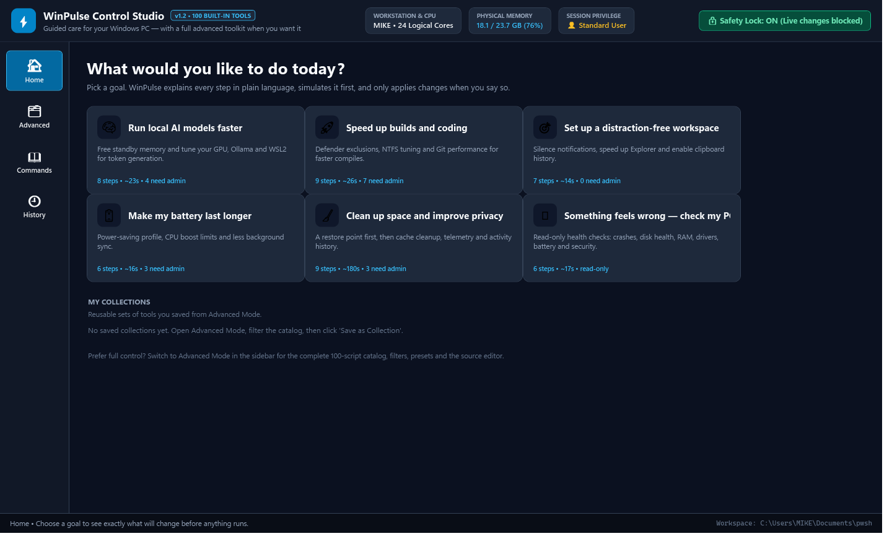
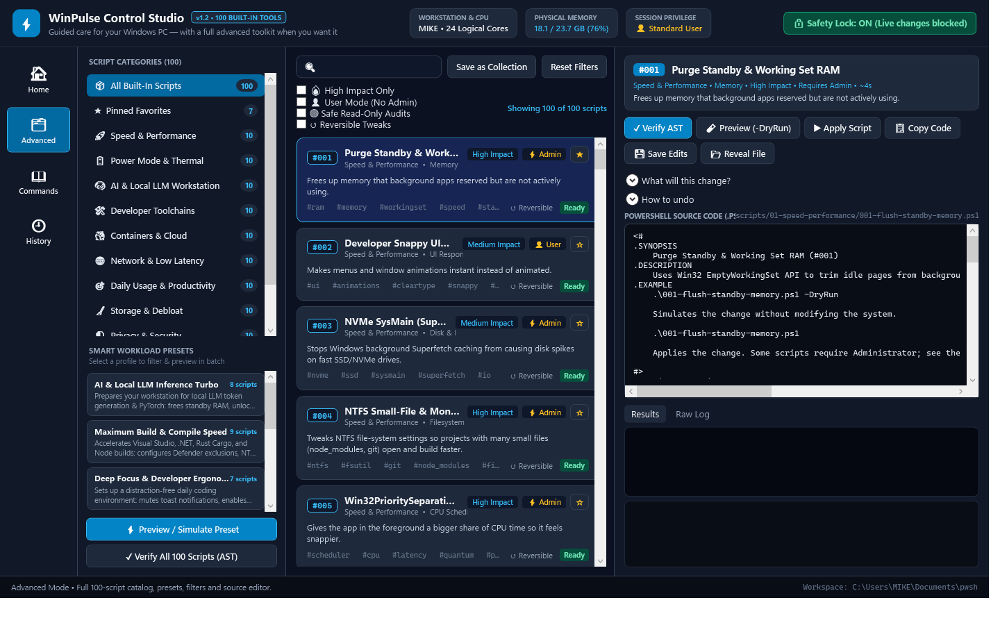
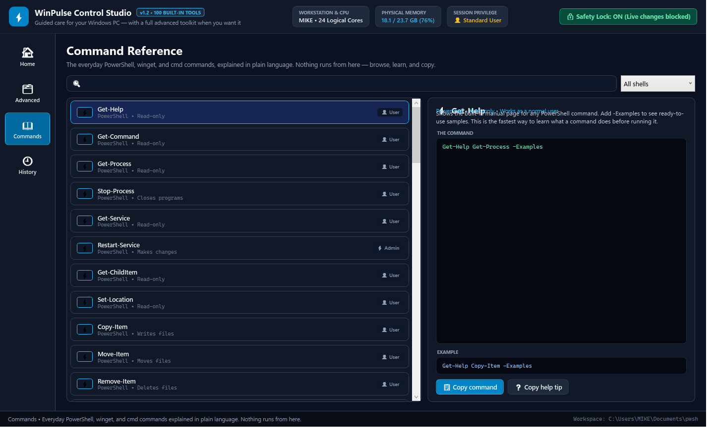
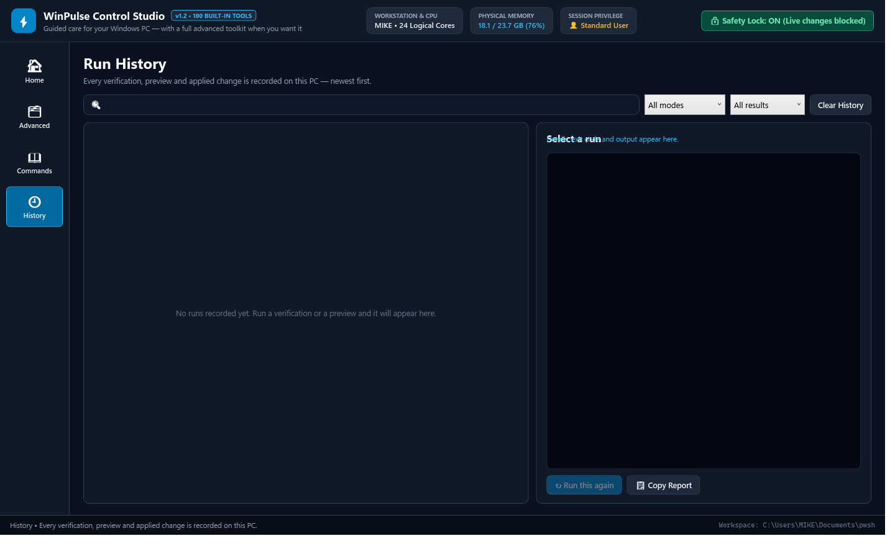

<div align="center">

# ⚡ WinPulse Control Studio

### **God-Mode Control for Windows 10 & 11 — Safe, Transparent, Zero Telemetry.**

A native `.NET 10` WPF command center for **Developers, Local AI/LLM Workstations, and Power Users** — powered by **100 audited, dry-run-ready PowerShell 7 scripts**.

<p>
  <a href="https://apps.microsoft.com/detail/9NR9XH6B2ZCZ"></a>
  
  
  
  <a href="LICENSE"></a>
</p>

<p>
  <a href="https://apps.microsoft.com/detail/9NR9XH6B2ZCZ">
    
  </a>
</p>

<p>
  <a href="https://apps.microsoft.com/detail/9NR9XH6B2ZCZ"><strong>Download on Microsoft Store</strong></a> •
  <a href="#-screenshots">Screenshots</a> •
  <a href="#-why-winpulse-studio">Why WinPulse</a> •
  <a href="#complete-catalog-of-100-built-in-powershell-scripts">100-Script Catalog</a> •
  <a href="PRIVACY.md">Privacy Policy</a>
</p>



</div>

---

## ✨ Why WinPulse Studio?

| 🛡️ Safety Lock (ON by Default) | 🔍 Preview Before Anything Changes | ↩️ Built-In Revert & History | 🔒 100% Offline & Private |
| :--- | :--- | :--- | :--- |
| Live system writes are **blocked at startup**. Unlock only when you're ready to apply. | Inspect full source code, run **static AST checks**, and simulate with `-DryRun` first. | Reversible tweaks include one-click **undo switches** plus a full local **Run History** log. | **Zero telemetry, zero cloud sync, zero background services.** Nothing ever leaves your PC. |

---

## 🚀 Download & Install

### Option 1: Microsoft Store *(Recommended)*
Install directly from the official Microsoft Store listing with automatic updates:

👉 **[Get WinPulse Studio on Microsoft Store](https://apps.microsoft.com/detail/9NR9XH6B2ZCZ)**

Or launch the Store page directly from **PowerShell / Windows Terminal**:
```powershell
winget install 9NR9XH6B2ZCZ
```
*(Or open in the Microsoft Store app: `ms-windows-store://pdp/?ProductId=9NR9XH6B2ZCZ`)*

> **One-time prerequisite:** WinPulse Studio uses **PowerShell 7 (`pwsh`)** to verify, preview, and run scripts. If you don't have it yet:
> ```powershell
> winget install Microsoft.PowerShell
> ```

---

## 📸 Screenshots

<table>
  <tr>
    <td align="center" width="50%">
      <br />
      <sub><strong>Guided Home</strong> — Pick a goal, preview every step, create a restore point</sub>
    </td>
    <td align="center" width="50%">
      <br />
      <sub><strong>Advanced Mode</strong> — 100 scripts, 5 smart presets, live AST & source editor</sub>
    </td>
  </tr>
  <tr>
    <td align="center" width="50%">
      <br />
      <sub><strong>Command Reference</strong> — Plain-English PowerShell, winget & cmd cheat sheet</sub>
    </td>
    <td align="center" width="50%">
      <br />
      <sub><strong>Run History</strong> — Every verify, preview, apply, and revert logged locally</sub>
    </td>
  </tr>
</table>

---

## Key Features

- **100 Built-In PowerShell Scripts (`.ps1`)**: Organized across 10 specialized categories (`scripts/01-speed-performance` through `scripts/10-diagnostics-recovery`), each with `CmdletBinding(SupportsShouldProcess = $true)`, `Set-StrictMode -Version Latest`, `-DryRun` simulation support, `#Requires -Version 7.0`, an `.EXAMPLE` help block, and a structured `trap` that reports failures cleanly.
- **Guided Home for everyday use**: Pick a plain-language goal (faster AI, faster builds, battery life, cleanup & privacy, or "something feels wrong"). WinPulse shows a step-by-step plan, explains what each step changes, requires every step to be previewed before Apply is enabled, and asks for explicit confirmation — with an optional one-click System Restore point.
- **Staged-trust Safety Lock (Default ON)**:
  - The desktop app boots with **Safety Lock: ON**. Live changes are blocked everywhere; AST verification and `-DryRun` previews are always allowed.
  - The guided flow turns the lock off only for its Apply batch and turns it back on when the batch finishes.
- **Richer script details**: Every script entry in `scripts/manifest.json` now includes a plain-language summary, a "what will this change" list, undo instructions, and prerequisites. Advanced Mode shows these in expandable panels.
- **Run history & reports**: Every verify, preview and applied change is logged to `%LOCALAPPDATA%\WinPulseStudio\history.json` with a History screen (filters, detail output, re-run, copy report, clear).
- **Revert support**: Scripts that ship a built-in undo switch (e.g. `-Revert`, `-RestoreNotifications`, `-EnableSysMain`) expose a **Revert Change** button in Advanced Mode; the manifest's undo guidance names the switch.
- **Custom collections**: Save any filtered selection of scripts from Advanced Mode as a named collection that appears on the Home screen.
- **5 Smart Workload Presets**:
  1. **AI & Local LLM Inference Turbo** (`#001`, `#011`, `#021`, `#022`, `#023`, `#024`, `#025`, `#030`)
  2. **Maximum Build & Compile Speed** (`#001`, `#003`, `#004`, `#005`, `#007`, `#018`, `#031`, `#032`, `#036`)
  3. **Deep Focus & Developer Ergonomics** (`#002`, `#061`, `#062`, `#063`, `#064`, `#065`, `#082`)
  4. **On-The-Go Ultra Battery Endurance** (`#012`, `#013`, `#017`, `#020`, `#059`, `#078`)
  5. **Deep Storage Clean & Privacy Shield** (`#091`, `#035`, `#038`, `#071`, `#073`, `#076`, `#081`, `#082`, `#088`)
- **Command Reference**: A dedicated **Commands** screen explains the everyday **PowerShell**, **winget**, and **cmd** commands in plain language — what each one does, whether it needs Administrator, how risky it is, and a ready-to-copy example. Nothing executes from this screen; it is a learn-and-copy cheat sheet (`commands/commands.json`).
- **Advanced Mode**: The full 3-column catalog with search, filters, favorites, presets, the built-in PowerShell source editor, structured **Results** and **Raw Log** tabs, and static AST verification.

---

## Prerequisites

- **Windows 10 version 2004 (build 19041) or Windows 11.**
- **PowerShell 7 (`pwsh`) on `PATH`.** The app is a .NET/WPF front end; it invokes `pwsh` for every verify, preview, apply, and revert. Windows PowerShell 5.1 (`powershell.exe`) is not sufficient. The app checks for `pwsh` at startup and shows a clear warning if it is missing.
- **.NET 10 SDK** only for building from source. The single-file exe and MSIX package are self-contained.
- **Administrator rights** for scripts whose manifest entry says `Requires Admin`. The app warns when the current session is not elevated.

## Quick Start (Build from Source)

### 0. Build the Standalone `.exe` (Portable Download & Share)
Build **one self-contained** `dist\WinPulseStudio.exe` — the full app, the .NET runtime, and all **100 built-in scripts bundled inside**. No .NET install or repo checkout needed on the target PC, but PowerShell 7 (`pwsh`) must be installed:
```powershell
pwsh -File .\Build-SingleExe.ps1
```
Then simply download/copy `dist\WinPulseStudio.exe` and double-click to run. On first launch the bundled scripts and catalog manifest are unpacked automatically.

The exe is signed with the local `CN=WinPulse Studio` certificate by default (pass `-SkipSigning` to skip). Windows SmartScreen may still warn on first run because the certificate is self-signed; see `CODE_SIGNING.md`.

### 1. Launch the Desktop Application
Double-click `Launch-WinPulseStudio.cmd` or run:
```powershell
.\src\WinPulseStudio\bin\Release\net10.0-windows\WinPulseStudio.exe
```
The app opens on the **Home** screen. Choose a goal for the guided flow, or switch to **Advanced Mode** in the sidebar for the full catalog. Or build and run via the .NET CLI:
```powershell
dotnet run --project .\src\WinPulseStudio\WinPulseStudio.csproj -c Release
```

### 2. Statically Verify All 100 Scripts (Zero Execution)
To parse every script's Abstract Syntax Tree (`[System.Management.Automation.Language.Parser]::ParseFile`), verify `[CmdletBinding()]` and `-DryRun` parameters, and resolve all 1,026 cmdlet invocations without running any script:
```powershell
pwsh -NoProfile -File .\tests\Validate-AllScripts.ps1
```

### 3. Build the MSIX Package (Local Testing)
```powershell
pwsh -File .\Build-MSIX.ps1
```
This publishes a self-contained `win-x64` layout, copies `scripts/`, `tests/`, `commands/`, `Package.appxmanifest`, `app.manifest`, and `Assets/` into `package\staging`, and packages `package\output\WinPulseStudio_1.2.0.0_x64.msix`. The package is signed with the local `CN=WinPulse Studio` certificate (timestamped via DigiCert), and the public certificate is exported to `package\output\WinPulseStudio.cer`. Pass `-SkipSigning` to skip signing.

### 4. Install and Verify the MSIX End to End
```powershell
pwsh -File .\Install-MSIX.ps1
```
This installs the package, gives it a real package identity, runs the installed app with `--verify-headless` (100 scripts, 5 presets, 56 command entries, `pwsh` present), and removes it again unless `-Keep` is passed. When the self-signed root is not trusted on the machine, it automatically falls back to Developer Mode registration (`Add-AppxPackage -Register`) so the test still exercises the real install path. To enable the fully signed install path, import the certificate once from an elevated shell:
```powershell
Import-Certificate -FilePath .\package\output\WinPulseStudio.cer -CertStoreLocation Cert:\LocalMachine\TrustedPeople
```

### 5. Check Store Readiness
```powershell
pwsh -File .\Test-StoreReadiness.ps1              # strict: blocks submission gaps
pwsh -File .\Test-StoreReadiness.ps1 -AllowSelfSigned   # local pre-flight
```
The gate checks placeholder URLs, version agreement, the 100-script catalog, command-reference counts, and the MSIX signature (trusted + timestamped). See `STORE_SUBMISSION_CHECKLIST.md` for the human/Partner Center steps.

### 6. Run the Automated Tests
```powershell
dotnet test .\WinPulseStudio.slnx -c Release
```

> **Error handling:** every built-in script installs a script-scope `trap` after `$ErrorActionPreference = 'Stop'`, so a terminating error prints `[ERROR] Script failed: <message>` and exits with code 1 instead of dumping a raw stack trace. The app records that as a clean failure in History.

> **History vs. change journal:** the History screen logs every verify, preview, applied run, and revert with its output. It is a run log, not a full system-change journal. Per-script undo switches are listed in the catalog and exposed by the **Revert Change** button in Advanced Mode.

> **Admin flag audit:** `requiresAdmin` was live-verified from a non-elevated shell for the power-plan scripts (`#012`, `#014`, `#019`). `powercfg /setacvalueindex`, `/setdcvalueindex`, and `/setactive` on `SCHEME_CURRENT` all succeed without elevation, so those entries correctly remain `requiresAdmin: false`.

---

## Complete Catalog of 100 Built-In PowerShell Scripts

### 01. Speed & Performance (`scripts/01-speed-performance/`)
| ID | Script File | Description |
|---|---|---|
| `#001` | `001-flush-standby-memory.ps1` | Purge Standby & Working Set RAM via Win32 `EmptyWorkingSet` |
| `#002` | `002-high-perf-visual-fx.ps1` | Developer Snappy UI Visual Effects (keeps ClearType crisp) |
| `#003` | `003-disable-sysmain-superfetch.ps1` | NVMe SysMain (Superfetch) Optimizer for low-jitter build I/O |
| `#004` | `004-ntfs-filesystem-turbo.ps1` | NTFS Small-File & Monorepo I/O Boost (`disable8dot3`, `disablelastaccess`) |
| `#005` | `005-priority-foreground-boost.ps1` | `Win32PrioritySeparation` (`0x26`) Foreground Quantum Boost |
| `#006` | `006-trim-nvme-storage.ps1` | NVMe ReTrim & Storage Slab Optimizer across fixed volumes |
| `#007` | `007-disable-search-indexer-burst.ps1` | Pause Windows Search Indexer (`WSearch`) during heavy builds |
| `#008` | `008-multimedia-system-profile-lowlatency.ps1` | MMCSS Low-Latency `SystemResponsiveness` & `NetworkThrottlingIndex` |
| `#009` | `009-startup-impact-audit-trim.ps1` | Startup App Auditor & Edge Background Prelaunch Slimmer |
| `#010` | `010-gamebar-dvr-background-off.ps1` | Disable GameDVR Background Frame Capture GPU Overhead |

### 02. Power Mode & Thermal (`scripts/02-power-thermal/`)
| ID | Script File | Description |
|---|---|---|
| `#011` | `011-unlock-ultimate-performance.ps1` | Unlock & Activate Hidden Microsoft Ultimate Performance Plan |
| `#012` | `012-eco-battery-saver-profile.ps1` | Ultra-Endurance On-The-Go Battery Profile (70% DC CPU Cap) |
| `#013` | `013-cpu-boost-policy-toggle.ps1` | CPU Turbo Boost Thermal & Fan Controller (`PERFBOOSTMODE`) |
| `#014` | `014-pcie-aspm-link-power-off.ps1` | Disable PCIe Link State Power Management (ASPM) on AC Power |
| `#015` | `015-usb-selective-suspend-guard.ps1` | USB Selective Suspend Guard for Hardware Debuggers & DACs |
| `#016` | `016-hibernate-faststartup-control.ps1` | Toggle Fast Startup & `hiberfil.sys` Reduced/Off Space Saver |
| `#017` | `017-battery-health-degradation-report.ps1` | Battery Wear Level, mWh Capacity & Cycle Count Inspector |
| `#018` | `018-power-throttling-exemption.ps1` | Exempt Compilers & IDEs from Windows 11 EcoQoS Throttling |
| `#019` | `019-processor-min-max-ac-tune.ps1` | Workstation AC Processor Minimum/Maximum State Tuner |
| `#020` | `020-sleep-study-wake-diagnostics.ps1` | Modern Standby, Wake Timers & Phantom Wake Source Auditor |

### 03. AI & Local LLM Workstation (`scripts/03-ai-workstation/`)
| ID | Script File | Description |
|---|---|---|
| `#021` | `021-gpu-tdr-timeout-ai-training.ps1` | Extend GPU TDR Timeout (`TdrDelay=60s`) for Long CUDA/DirectML Kernels |
| `#022` | `022-hardware-accelerated-gpu-scheduling.ps1` | Enable Hardware-Accelerated GPU Scheduling (`HwSchMode=2`) |
| `#023` | `023-ollama-server-tuning.ps1` | Ollama Local LLM Flash-Attention & `q8_0` KV-Cache Tuner |
| `#024` | `024-vram-hog-process-reaper.ps1` | VRAM Pre-Flight Cleaner for Local AI Inference |
| `#025` | `025-wsl2-ai-memory-gpu-config.ps1` | WSL2 `.wslconfig` AI & CUDA Memory Optimizer (`autoMemoryReclaim=gradual`) |
| `#026` | `026-huggingface-pytorch-cache-audit.ps1` | AI Model Weights Cache Auditor (HuggingFace, Ollama, PyTorch, LM Studio) |
| `#027` | `027-nvidia-cuda-persistence-power.ps1` | NVIDIA GPU Compute Power Limit & Clock Tuner (`nvidia-smi`) |
| `#028` | `028-windows-copilot-recall-control.ps1` | Windows Copilot & Recall Background AI Resource Controller |
| `#029` | `029-python-ai-venv-cuda-doctor.ps1` | Python AI Toolchain, `uv`, CUDA Path & `nvcc` Doctor |
| `#030` | `030-npu-directml-compute-audit.ps1` | NPU, GPU & DirectML Compute Accelerator Hardware Inventory |

### 04. Developer Toolchains (`scripts/04-dev-toolchains/`)
| ID | Script File | Description |
|---|---|---|
| `#031` | `031-windows-defender-dev-exclusions.ps1` | Defender Real-Time Build & Compiler Exclusions (`dotnet`, `cargo`, `node`, `git`) |
| `#032` | `032-enable-windows-dev-mode-longpaths.ps1` | Enable Developer Mode Symlinks & Win32 Long Paths (`>260` chars) |
| `#033` | `033-kill-zombie-dev-ports.ps1` | Zombie Localhost Dev Port Reaper (`3000`, `5173`, `8000`, `8080`, `5000`) |
| `#034` | `034-node-modules-graveyard-cleaner.ps1` | Stale `node_modules`, `.next` & Rust `target` Artifact Pruner |
| `#035` | `035-package-manager-cache-purge.ps1` | Unified Package Manager Cache Purge (`npm`, `pnpm`, `pip`, `NuGet`) |
| `#036` | `036-git-global-performance-tuning.ps1` | Git Monorepo & Filesystem Cache Turbo Config (`fscache`, `manyFiles`) |
| `#037` | `037-wsl2-vhdx-compact-shrink.ps1` | WSL2 & Docker Virtual Disk (`ext4.vhdx`) Compactor |
| `#038` | `038-vscode-extension-cache-cleaner.ps1` | VS Code / Cursor Cached VSIX, Crashpad & Log Cleaner |
| `#039` | `039-env-path-deduplicator.ps1` | System & User `PATH` Deduplicator & Dead-Directory Cleaner |
| `#040` | `040-dev-drive-refs-advisor.ps1` | Dev Drive (`ReFS`) & Filesystem Filter Driver Auditor |

### 05. Containers, Virtualization & Cloud (`scripts/05-containers-cloud/`)
| ID | Script File | Description |
|---|---|---|
| `#041` | `041-docker-deep-prune.ps1` | Docker Engine & BuildKit Cache Deep Prune |
| `#042` | `042-wsl-service-restart-reset.ps1` | WSL2 Distro Inspector & `WslService` Cold Restart |
| `#043` | `043-hyperv-vswitch-nat-fix.ps1` | Repair WSL2 / Hyper-V Host Network Service (`hns`) NAT Routing |
| `#044` | `044-windows-sandbox-dev-launcher.ps1` | Generate Isolated Windows Sandbox (`.wsb`) Profile with vGPU |
| `#045` | `045-kubeconfig-context-auditor.ps1` | Kubernetes `~/.kube/config` Context & Cluster Auditor |
| `#046` | `046-ssh-agent-key-autoloader.ps1` | OpenSSH Agent Auto-Start & `~/.ssh` Key Auditor |
| `#047` | `047-local-hosts-dev-domains.ps1` | Hosts File Local Dev Domain & Docker Mapping Auditor |
| `#048` | `048-cloud-cli-token-cache-clean.ps1` | Cloud CLI Log & Telemetry Cleaner (AWS, Azure, Google Cloud) |
| `#049` | `049-hypervisor-launchtype-toggle.ps1` | Hyper-V Hypervisor LaunchType Switcher (`Auto` vs `Off`) |
| `#050` | `050-container-port-forward-bridge.ps1` | WSL2 / Container to LAN Port Proxy Bridge (`netsh portproxy`) |

### 06. Network & Low Latency (`scripts/06-network-latency/`)
| ID | Script File | Description |
|---|---|---|
| `#051` | `051-dns-flush-winsock-reset.ps1` | Flush DNS Resolver Cache & Clear ARP Table |
| `#052` | `052-cloudflare-quad9-fast-dns.ps1` | Benchmark & Switch to Fastest Public DNS (`1.1.1.1` / `8.8.8.8` / `9.9.9.9`) |
| `#053` | `053-tcp-bbr-autotuning-optimizer.ps1` | TCP Stack, Receive Window Auto-Tuning & RSS Optimizer |
| `#054` | `054-nagle-algorithm-low-latency.ps1` | Disable Nagle's Algorithm (`TcpAckFrequency=1`, `TCPNoDelay=1`) |
| `#055` | `055-wifi-roaming-power-saving-fix.ps1` | Wi-Fi 6/6E/7 Link Telemetry & Maximum Performance Power Mode |
| `#056` | `056-network-connection-radar.ps1` | Live External TCP Connection & Owning Process Radar |
| `#057` | `057-smb-signing-lan-transfer-boost.ps1` | LAN SMB3 Multichannel & Large MTU NAS Transfer Optimizer |
| `#058` | `058-vpn-split-tunnel-route-fixer.ps1` | VPN Interface Metric & Default Route Split-Tunnel Doctor |
| `#059` | `059-delivery-optimization-p2p-off.ps1` | Disable Windows Update P2P Upload Bandwidth Drain |
| `#060` | `060-latency-jitter-mtr-diagnostic.ps1` | Multi-Target Ping, RTT & Jitter Benchmark |

### 07. Daily Usage & Productivity (`scripts/07-daily-productivity/`)
| ID | Script File | Description |
|---|---|---|
| `#061` | `061-deep-focus-do-not-disturb.ps1` | Deep Focus Coding Mode (Mute Toast Notifications & Distractions) |
| `#062` | `062-scheduled-dark-light-theme.ps1` | Instant System & App Dark / Light Mode Switcher |
| `#063` | `063-clipboard-history-cloud-sync.ps1` | Enable `Win+V` Multi-Slot Clipboard History & Sanitizer |
| `#064` | `064-explorer-developer-ergonomics.ps1` | File Explorer Developer Ergonomics (Show Extensions, Dotfiles, Compact View) |
| `#065` | `065-classic-right-click-context-menu.ps1` | Toggle Windows 11 Full Classic Right-Click Context Menu |
| `#066` | `066-audio-endpoint-quick-reset.ps1` | Restart Windows Audio Stack & Bluetooth Headset Recovery |
| `#067` | `067-multi-monitor-dpi-window-rescue.ps1` | Rescue Off-Screen Stranded Windows to Primary Display |
| `#068` | `068-night-light-blue-light-filter.ps1` | Late-Night Coding Display Brightness & Eye-Care Controller |
| `#069` | `069-end-of-day-workspace-shutdown.ps1` | End-of-Day Uncommitted Git Repo Audit & Workspace Wrap-Up |
| `#070` | `070-winget-daily-silent-upgrader.ps1` | WinGet Outdated App Scanner & Silent Batch Upgrader |

### 08. Storage & Debloat (`scripts/08-storage-cleanup/`)
| ID | Script File | Description |
|---|---|---|
| `#071` | `071-temp-prefetch-shader-purge.ps1` | Deep Temp, DirectX & NVIDIA/AMD Shader Cache Purge |
| `#072` | `072-windows-update-dism-cleanup.ps1` | WinSxS Component Store & Update Cache Slimmer (`DISM`) |
| `#073` | `073-crash-dump-wer-cleaner.ps1` | Purge Memory Dumps, Minidumps & WER Crash Report Queues |
| `#074` | `074-recycle-bin-shadowcopy-trim.ps1` | Empty All Recycle Bins & Inspect Volume Shadow Storage |
| `#075` | `075-large-file-duplicate-hunter.ps1` | Top 25 Largest Files & Forgotten ISO/Archive Hunter |
| `#076` | `076-browser-cache-vacuum.ps1` | Multi-Browser Media & Code Cache Vacuum (Edge, Chrome, Brave) |
| `#077` | `077-windows-bloatware-remover.ps1` | Consumer Appx Bloatware Auditor & Debloater |
| `#078` | `078-onedrive-sync-throttle-disable.ps1` | OneDrive Background Sync Controller |
| `#079` | `079-delivery-optimization-cache-clear.ps1` | Purge Windows Delivery Optimization Peer Cache |
| `#080` | `080-appdata-orphaned-folder-finder.ps1` | `AppData` Top Space Consumers & Orphaned Folder Auditor |

### 09. Privacy & Security (`scripts/09-privacy-security/`)
| ID | Script File | Description |
|---|---|---|
| `#081` | `081-disable-windows-telemetry-diagtrack.ps1` | Minimize Windows Telemetry & Disable `DiagTrack` Service |
| `#082` | `082-disable-start-menu-bing-ads.ps1` | Disable Start Menu Bing Web Search & Suggested Ads |
| `#083` | `083-uac-smartscreen-security-audit.ps1` | UAC, SmartScreen & Exploit Guard Security Posture Auditor |
| `#084` | `084-firewall-outbound-telemetry-block.ps1` | Windows Firewall Public Profile Inbound Exposure Auditor |
| `#085` | `085-bitlocker-tpm-security-check.ps1` | TPM 2.0, Secure Boot & BitLocker Encryption Inspector |
| `#086` | `086-usb-badusb-storage-lockdown.ps1` | USB Mass Storage Write-Protect / Read-Only Shield |
| `#087` | `087-camera-microphone-privacy-shield.ps1` | Camera & Microphone Hardware Consent History Auditor |
| `#088` | `088-clear-activity-history-timeline.ps1` | Disable Windows Activity History & Cloud Timeline Upload |
| `#089` | `089-spectre-vbs-hvci-status-control.ps1` | Virtualization-Based Security (VBS / Memory Integrity) Inspector |
| `#090` | `090-hosts-ad-tracker-shield.ps1` | Telemetry & Ad-Tracker Hosts Blocklist Manager |

### 10. Diagnostics & Recovery (`scripts/10-diagnostics-recovery/`)
| ID | Script File | Description |
|---|---|---|
| `#091` | `091-create-system-restore-point.ps1` | Create Instant System Restore Checkpoint (`Checkpoint-Computer`) |
| `#092` | `092-sfc-dism-system-healer.ps1` | DISM Image Health & SFC Integrity Verifier |
| `#093` | `093-bsod-whea-crash-analyzer.ps1` | BSOD BugCheck & WHEA Hardware Error Event Analyzer |
| `#094` | `094-smart-disk-endurance-monitor.ps1` | NVMe / SSD SMART Health, Temperature & Wear Level Monitor |
| `#095` | `095-ram-spd-memory-diagnostic.ps1` | Physical RAM DIMM Slot, Speed & Dual-Channel Inspector |
| `#096` | `096-windows-time-ntp-resync.ps1` | Force High-Precision NTP Clock Resync (Fix OAuth/JWT Drift) |
| `#097` | `097-windows-store-wsreset-healer.ps1` | Microsoft Store & App Installer Cache Healer |
| `#098` | `098-print-spooler-stuck-queue-fix.ps1` | Flush Stuck Print Spooler & Virtual PDF Queue |
| `#099` | `099-driver-signature-problem-audit.ps1` | Faulty & Degraded PnP Device Driver Inspector |
| `#100` | `100-export-full-workstation-spec.ps1` | Export Full Developer & AI Workstation Spec Report (JSON) |
